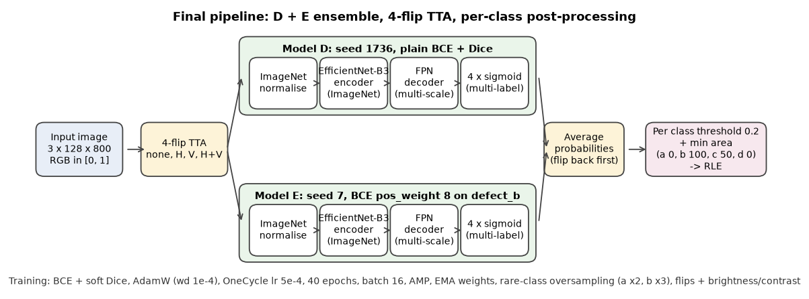
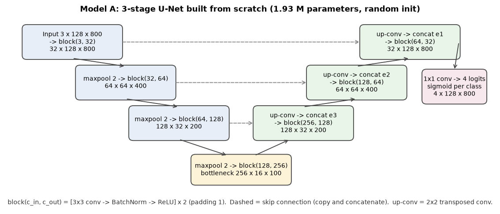
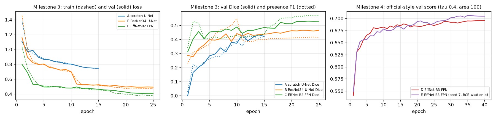
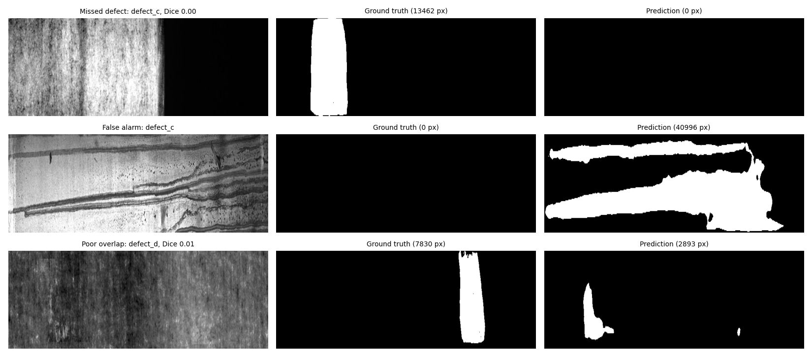

**Kaggle notebook:** `DL-23f3001736-notebook-t32026` (v14) | **W&B:** `23f3001736-t32026` | **GitHub:** `23f3001736/dl-genai-project-t32026` | **Demo:** huggingface.co/spaces/23f3001736/surfaceguard-defect-segmentation

## 1. Abstract

The SurfaceGuard AI competition asks for a pixel mask of four defect types (`defect_a` to `defect_d`) on 128 x 800 grayscale surface strips, scored by an official metric of 70% Dice on defect pairs, 20% false-positive pixels and 10% empty accuracy. I built a combination-stratified 80/20 split and compared three model types: a **U-Net built from scratch**, a **pretrained ResNet34 U-Net**, and my choice, an **FPN with a pretrained EfficientNet** encoder. All were trained with BCE + Dice, AdamW, OneCycle, mixed precision and logged to W&B. The best design was trained longer as two EfficientNet-B3 FPN models (D and E), averaged with 4-flip test-time augmentation and per-class threshold and minimum-area post-processing. The final pipeline scores **0.7307 on validation** (presence macro F1 0.782) and **0.66965 on the public leaderboard** (cutoff 0.65, rank 565 of 1,409). Main learnings: pretrained encoders gave the largest gain, and post-processing tuned with the official metric matters almost as much as the model.

## 2. Introduction

**Problem statement.** Each training image has four (image, defect type) rows with a run-length-encoded mask (1-based, column-major); an empty mask is a single space. For the 3,000 test images I must predict all four masks. One image can contain several defect types, so this is **multi-label semantic segmentation**.

**Project objectives.** (1) Cross the 0.65 cutoff with a trained model; (2) build and compare at least three model types (scratch, pretrained, own choice) with W&B tracking; (3) handle class imbalance and tune post-processing on the official metric; (4) deploy the final model.

**Report structure.** Section 3 covers the data, Section 4 the input representation, Section 5 the three model types, Section 6 the results and comparison, Section 7 the conclusions and Section 8 the references.

## 3. Dataset & preprocessing

**Dataset.** 11,393 training images (45,572 image-class rows) and 3,000 test images, each 128 x 800 pixels, grayscale stored as 3-channel JPEG.

**EDA (Milestones 1 and 2).**

| Statistic | Value |
|---|---|
| Clean images (no defect) | 5,516 (48%) |
| Images with more than one defect type | 1,198 |
| Validation positives per class (of 2,279 images) | a 216, b 63, c 820, d 342 |

- **Strong class imbalance:** `defect_c` is common, `defect_b` is very rare and often small.
- **Co-occurrence:** the co-occurrence matrix C = X^T X and the phi coefficient show that some defects appear together, but their pixel overlap is small. This supports one sigmoid output per class.
- **Aspect ratio 6.25 : 1:** resizing to a square would squash thin defects, so I train at native resolution.
- **Naive Dice trap:** a mean Dice that counts empty pairs as 1 prefers threshold 0.9, but the official metric prefers 0.3. All tuning uses the official-style score.

**Preprocessing.** RLE decode to a 4 x 128 x 800 mask; images scaled to [0, 1]. **Split:** 80/20, stratified on the combination string of defects in each image (e.g. `0101`), seed 1736; combinations with one image go to train. **Imbalance:** images with `defect_a` are sampled 2x and with `defect_b` 3x (Milestone 4).

**Data augmentation.** Horizontal and vertical flips (defects have no fixed orientation), and from Milestone 4 small brightness (+/-0.08) and contrast (+/-15%) changes, done on the GPU. These keep the labels valid and make the model robust to lighting differences between strips.

## 4. Input representation (adapted from "Tokenization strategy")

This project uses images, not text, so there is no tokenizer. The equivalent step is turning a strip into a tensor the network can read:

- **Pixels to tensor:** each image becomes a float tensor 3 x 128 x 800 in [0, 1]. The grayscale channel is repeated 3 times so ImageNet-pretrained encoders can be used unchanged.
- **Normalisation inside the model:** a small `Normalized` wrapper subtracts the ImageNet mean and divides by the std, so training, validation, test and the deployed demo all get the same input.
- **No resizing or patching:** 128 and 800 are divisible by 32, so encoders with 5 down-sampling steps work at full resolution.
- **Efficient pipeline:** from Milestone 4 the whole training split is kept in memory as uint8 (2 GB instead of 8 GB in float32), and augmentation runs on the GPU, which made epochs faster.
- **Alternatives tried:** a single-channel grayscale input for the Milestone 1 baseline. The 3-channel RGB input was kept because it lets pretrained weights load directly.

## 5. Modeling & experimentation

All models output **4 logits per pixel with a sigmoid** (multi-label), and use the loss **BCE + soft Dice**: BCE gives stable per-pixel gradients and Dice targets overlap directly, so the many background pixels do not dominate. Common setup: AdamW (weight decay 1e-4), OneCycle LR (10% warmup then cosine decay, stepped every batch), batch 16, mixed precision (AMP), flips, one W&B run per model.

### 5.1 Model 1: fine-tuned pretrained encoder-decoder (models B, C, D, E)

**Architecture.** B is a U-Net decoder with an ImageNet **ResNet34** encoder [He et al., 2016] (residual blocks, 24.4 M parameters). C, D and E use a **Feature Pyramid Network** decoder [Lin et al., 2017] on **EfficientNet-B2/B3** encoders [Tan & Le, 2019] (9.5 M and 12.5 M parameters), implemented with `segmentation_models_pytorch` [Iakubovskii, 2019].

**Salient points.** Residual and MBConv blocks give strong low-level texture features learned on ImageNet. FPN merges features from several scales, which suits defects ranging from tiny spots to long scratches. EfficientNet gives more accuracy per parameter than ResNet34.

**Fine-tuning strategy.** No layers were frozen: the whole network was fine-tuned, because industrial surface textures differ from ImageNet photos. Pretrained models used a lower LR (3e-4 for B and C, 5e-4 for D and E) than the scratch model (1e-3) to avoid destroying the pretrained features. B and C trained 25 epochs, keeping the best epoch by val Dice. D and E trained **40 epochs** with rare-class oversampling and an **EMA** of the weights; E also uses BCE `pos_weight = 8` on `defect_b`. No quantization was used for training; for the demo the D + E ensemble with TTA was exported to one **ONNX** graph (97 MB) that runs in the browser.

{width=92%}

### 5.2 Model 2: custom deep learning model (model A, built from scratch)

**Architecture.** A 3-stage U-Net [Ronneberger et al., 2015] written from scratch in PyTorch, base width 32, **1.93 M parameters**, random initialisation.

{width=88%}

**Salient points.** The encoder halves the resolution three times to see wider context; the decoder up-samples back to full size, and **skip connections** copy the encoder features across so fine defect edges are not lost. BatchNorm keeps training stable without pretrained weights. Three stages (not four or five) keep the model small enough to train at full 128 x 800 resolution with batch 16.

### 5.3 Model 3: my choice (adapted from "RNN-based model")

An RNN is designed for sequences such as text and is not a natural fit for 2-D image masks, and my project guideline asks for a third model "of your choice". My choice is the **FPN with an EfficientNet encoder** (model C, later D and E, described in 5.1). I chose it over a second U-Net because the FPN decoder adds multi-scale features, which the error analysis showed matters for the mix of tiny and large defects. It was the best of the three in Milestone 3 and became the final model.

## 6. Performance & comparative analysis

**Metrics.** *Official score* = 0.7 x mean Dice on pairs that have a defect + 0.2 x (1 - false-positive pixel fraction on empty pairs) + 0.1 x empty accuracy. I also report *presence* accuracy, precision, recall and macro F1 for "does this (image, class) pair contain the defect".

**Training performance (curves from my W&B project).**

{width=100%}

The scratch U-Net's train and val loss stay close but high (underfitting). The pretrained models drop much lower. C reaches the best val Dice and F1 and was still improving at epoch 25, so D and E were trained for 40 epochs; E (BCE weight on `defect_b`) ends above D.

**Comparative report (same validation split).**

| Model | Params | Epochs, time per epoch (T4) | Val Dice (defect pairs) | Presence accuracy | Presence macro F1 |
|---|---|---|---|---|---|
| A scratch U-Net | 1.9 M | 15, ~165 s | 0.434 | 0.581 | 0.354 |
| B ResNet34 U-Net | 24.4 M | 25, ~125 s | 0.466 | 0.923 | 0.412 |
| C EffNet-B2 FPN | 9.5 M | 25, ~120 s | 0.530 | 0.943 | 0.570 |
| **D + E EffNet-B3 FPN, 4-flip TTA** | 2 x 12.5 M | 40 each, ~165 s | **0.620** | | **0.782** |

**Trade-offs.** B has the most parameters but is beaten by the smaller C, so encoder quality matters more than size. D + E with TTA is the most accurate but costs 2 models x 4 views = 8 forward passes per image at inference; on CPU this is about 3 s per image, still fine for the demo.

**What each step of the final pipeline adds (validation, official score).**

| Step | Score |
|---|---|
| D, no TTA | 0.6971 |
| D, 4-flip TTA | 0.7097 |
| E, 4-flip TTA | 0.7263 |
| **D + E, 4-flip TTA (final)** | **0.7307** |

Tuning check: thresholds tuned on half of the validation images and scored on the other half give 0.7303 and 0.7289, so the tuning is not overfitted.

**Final model per class (D + E, validation).**

| Class | Positives | Dice | Precision | Recall | Presence F1 |
|---|---|---|---|---|---|
| defect_a | 216 | 0.402 | 0.733 | 0.634 | 0.680 |
| defect_b | 63 | 0.414 | 0.765 | 0.619 | 0.684 |
| defect_c | 820 | 0.640 | 0.857 | 0.894 | 0.875 |
| defect_d | 342 | 0.746 | 0.868 | 0.906 | 0.887 |

**Error analysis.** The rare classes `defect_a` and `defect_b` miss about 37% of their defects. Most false alarms are `defect_c` (122 of 231), the most common class. Typical failures (below): a large defect next to a dark band at the strip edge is missed; a clean strip with long scratch-like stripes is predicted as a large `defect_c`; a `defect_d` is found in the wrong place.

{width=82%}

**Kaggle performance.** Final public leaderboard score **0.66965**, rank **565 of 1,409** (cutoff 0.65). Leaderboard history: M1 0.373, M2 0.575, M3 0.615, M4 0.665, M5 0.670.

## 7. Conclusion & future work

**Key learnings.** (1) Pretrained encoders gave the biggest jump; the scratch U-Net underfits. (2) Because 30% of the metric is about empty pairs, per-class thresholds and minimum areas move the score as much as a better model. (3) Use the official metric for every decision; the naive Dice would have chosen the wrong threshold. (4) Clean tooling (one split, W&B runs, milestone branches) made comparisons fair.

**Challenges.** *Class imbalance*: solved partly with oversampling and a BCE weight on `defect_b`. *GPU time and memory*: uint8 in-memory data, GPU augmentation and AMP. *Validation vs leaderboard gap* (0.731 vs 0.670): on test the model predicts `defect_d` on 31% of images against 16% on validation. A confidence filter and a third ensemble model (F, another seed) both lowered the validation score (0.7225 and 0.7279), so the gap looks like a real test distribution shift rather than false alarms, and I kept the D + E pipeline.

**Areas for improvement.** An image-level classifier to decide "defect or not" before segmenting; Lovasz or focal loss for the rare classes; 5-fold cross-validation for more stable thresholds; a larger encoder (EfficientNet-B5) or a U-Net++ decoder for ensemble diversity.

## 8. References

1. O. Ronneberger, P. Fischer, T. Brox. *U-Net: Convolutional Networks for Biomedical Image Segmentation.* MICCAI 2015.
2. T.-Y. Lin et al. *Feature Pyramid Networks for Object Detection.* CVPR 2017.
3. K. He, X. Zhang, S. Ren, J. Sun. *Deep Residual Learning for Image Recognition.* CVPR 2016.
4. M. Tan, Q. Le. *EfficientNet: Rethinking Model Scaling for Convolutional Neural Networks.* ICML 2019.
5. F. Milletari, N. Navab, S.-A. Ahmadi. *V-Net (soft Dice loss).* 3DV 2016.
6. I. Loshchilov, F. Hutter. *Decoupled Weight Decay Regularization (AdamW).* ICLR 2019.
7. L. Smith, N. Topin. *Super-Convergence (one-cycle learning rate).* 2019.
8. P. Micikevicius et al. *Mixed Precision Training.* ICLR 2018.
9. P. Iakubovskii. *Segmentation Models PyTorch.* GitHub, 2019. A. Paszke et al. *PyTorch.* NeurIPS 2019. Tools: Weights & Biases, ONNX Runtime, Kaggle.
