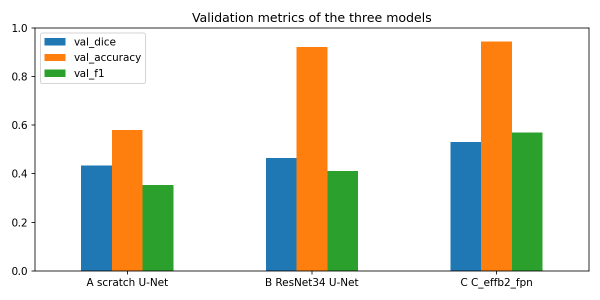

**Kaggle notebook:** `DL-23f3001736-notebook-t32026` (version 14) | **W&B project:** `23f3001736-t32026` | **GitHub:** `23f3001736/dl-genai-project-t32026`

**Final result:** public leaderboard **0.66965** (cutoff 0.65), validation score 0.7308.

## 1. Problem statement

Each image is a grayscale strip of an industrial surface, 128 x 800 pixels. It can contain any mix of four defect types (`defect_a` to `defect_d`). For every (image, defect type) pair the model must predict a pixel mask, written as run-length encoding (1-based starts, column-major order). An empty mask is written as a single space.

The official metric combines three parts:

- **70%** Dice, only on pairs that really have a defect
- **20%** false positive score: how few pixels are predicted on pairs that should be empty
- **10%** empty accuracy: how often an empty pair is predicted as empty

So the task is a **multi-label segmentation** problem, where predicting "nothing" correctly matters almost as much as drawing good masks.

## 2. Data

| Item | Value |
|---|---|
| Training images | 11,393 (45,572 image-class rows) |
| Test images | 3,000 (12,000 rows) |
| Clean images (no defect) | 5,516 (about 48%) |
| Images with more than one defect | 1,198 |
| Image size | 128 x 800, grayscale (stored as 3-channel) |

Main points from the EDA (Milestones 1 and 2):

- **Strong class imbalance.** `defect_c` is the most common, `defect_b` is very rare. Many `defect_b` masks are also small, so a model can ignore it and still get a decent loss.
- **Co-occurrence.** I computed the co-occurrence matrix C = X^T X and the phi coefficient. Some defects appear together, but the pixel overlap between classes is small. This is why I used **sigmoid outputs (multi-label)** rather than softmax: one pixel or one image can belong to more than one class.
- **Aspect ratio.** The images are 6.25 times wider than they are tall. I trained at native resolution (128 x 800), so the thin defects are not distorted or shrunk.
- **Naive Dice trap.** A naive mean Dice that counts empty pairs as Dice 1 prefers a high threshold (0.9), but the official metric prefers 0.3. So all tuning was done with the official-style score.

**Split.** An 80/20 split, stratified on the *combination string* of defects in each image (for example `a+c`). This keeps the rare combinations in both train and validation. Combinations with only one image go to train.

## 3. Methodology and pipeline

```
image -> model(s) with 4-flip TTA -> average probabilities
      -> per-class threshold -> per-class minimum area filter -> RLE -> submission.csv
```

- **Input:** RGB image scaled to [0, 1], then ImageNet normalisation inside the model (a `Normalized` wrapper), so pretrained encoders get the input they expect.
- **Augmentation:** horizontal and vertical flips. From Milestone 4 also small brightness and contrast changes (done on the GPU).
- **Loss:** BCE + soft Dice. BCE gives stable per-pixel gradients. Dice directly targets overlap and is less affected by the many background pixels. Model E also uses `pos_weight = 8` on `defect_b` in the BCE to push recall on the rarest class.
- **Optimizer:** AdamW (weight decay 1e-4) with a OneCycle learning rate schedule (10% warmup, then cosine decay), stepped every batch.
- **Mixed precision** (AMP) on a Kaggle T4 GPU, which roughly halves activation memory.
- **Rare-class oversampling:** images with `defect_a` are drawn 2x as often, and images with `defect_b` 3x as often.
- **EMA** of the weights during training, used for validation and saving.

## 4. Models

The project requires three models: one from scratch, one pretrained, and one of my choice. All three were trained on the same split with the same loss and metrics, and logged to W&B.

| Model | Architecture | Encoder | LR | Role |
|---|---|---|---|---|
| A | 3-stage U-Net (base width 32) | none, random init | 1e-3 | built from scratch |
| B | U-Net (smp) | ResNet34, ImageNet | 3e-4 | pretrained |
| C | FPN (smp) | EfficientNet-B2, ImageNet | 3e-4 | my choice |
| D | FPN, 40 epochs, EMA, oversampling | EfficientNet-B3, ImageNet | 5e-4 | final model 1 |
| E | same as D, seed 7, BCE weight 8 on `defect_b` | EfficientNet-B3, ImageNet | 5e-4 | final model 2 |

{width=100%}

**Why FPN with EfficientNet.** FPN merges features from several scales. That suits this data, where defects range from tiny spots to long scratches across the strip. EfficientNet gives strong features for few parameters, so I could train at full resolution with batch size 16.

## 5. Results

### 5.1 Three-model comparison (Milestone 3, best epoch, same validation split)

| Model | Best epoch | Val loss | Val Dice (defect pairs) | Presence accuracy | Presence macro F1 |
|---|---|---|---|---|---|
| A scratch U-Net | 11 | 0.783 | 0.434 | 0.581 | 0.354 |
| B ResNet34 U-Net | 22 | 0.493 | 0.466 | 0.923 | 0.412 |
| C EffNet-B2 FPN | 23 | 0.410 | **0.530** | **0.943** | **0.570** |

{width=55%}

Pretraining helped a lot. The scratch U-Net learned rough shapes but produced many false alarms on clean images (accuracy 0.58). Model C was best on every metric and was still improving at the end, so I trained it longer in Milestone 4.

### 5.2 Final pipeline: what each step adds (validation, official-style score)

| Step | Dice (defect pairs) | Empty accuracy | FP pixel fraction | Score |
|---|---|---|---|---|
| D, no TTA | 0.5702 | 0.9799 | 0.0004 | 0.6971 |
| D, 4-flip TTA | 0.5900 | 0.9683 | 0.0006 | 0.7097 |
| E, 4-flip TTA | 0.6136 | 0.9685 | 0.0005 | 0.7263 |
| **D + E, 4-flip TTA** | **0.6198** | 0.9699 | 0.0006 | **0.7307** |
| + connected component filter | | | | 0.7308 |

Every step adds a little: TTA +0.013, model E's `defect_b` weighting +0.017, and the ensemble +0.004. The connected component filter gave no real gain (0.7308 vs 0.7307), so I left it off to keep the pipeline simple.

### 5.3 Final model per class (D + E, validation, 2,279 images)

"Presence" means the image-class pair has a defect. Precision, recall and F1 are for predicting that correctly.

| Class | Positives | Dice (defect pairs) | Precision | Recall | Presence F1 | Missed | False alarms |
|---|---|---|---|---|---|---|---|
| defect_a | 216 | 0.402 | 0.733 | 0.634 | 0.680 | 79 | 50 |
| defect_b | 63 | 0.414 | 0.765 | 0.619 | 0.684 | 24 | 12 |
| defect_c | 820 | 0.640 | 0.857 | 0.894 | 0.875 | 87 | 122 |
| defect_d | 342 | 0.746 | 0.868 | 0.906 | 0.887 | 32 | 47 |
| **Macro** | | **0.551** | | | **0.782** | | |

Overall Dice on defect pairs 0.620, empty accuracy 0.970, score 0.7307. The presence macro F1 went from 0.570 (model C) to **0.782**.

### 5.4 Leaderboard history

| Milestone | Submission | Public LB |
|---|---|---|
| Registration | dummy baseline | 0.000 |
| M1 | basic U-Net baseline | 0.373 |
| M2 | ResNet34 U-Net, BCE+Dice, tuned threshold and area | 0.575 |
| M3 | EfficientNet-B2 FPN | 0.615 |
| M4 | ensemble of two EfficientNet-B3 FPNs | 0.665 |
| **M5** | **D + E, 4-flip TTA, tuned per-class thresholds** | **0.670** |

## 6. Training details and experiments

- **Hyperparameter search for post-processing:** threshold from 0.20 to 0.80 (step 0.05) and minimum area from 0 to 8,000 pixels, chosen per class on the validation split.
- **Is the tuning overfitted?** I tuned on even-numbered validation images and scored on odd ones, and the other way round: 0.7303 and 0.7289. A gap of about 0.001 to 0.002 means the chosen thresholds are not just fitting noise.
- **Controlled experiments (Milestone 4, 1,200-image subset, 6 epochs, runs R0, R0b, R1, R2 in W&B):** bounded square-root sampling for imbalance, a warmup plus cosine schedule (including the bug of stepping the scheduler per epoch instead of per batch), early stopping, AMP memory, and gradient accumulation.
- **Memory:** in the Milestone 5 worked example the same tensor needs 8.2 GB in float32, 4.1 GB in float16 and 2.0 GB in uint8. This is why I keep the training images in memory as uint8 and train with AMP.
- **Inference budget:** the final notebook (two models, 4-flip TTA on 3,000 test images) runs within Kaggle's time and memory limits.

## 7. Error analysis

- **The rare classes are the weak ones.** `defect_a` (216 positives) and `defect_b` (63) have Dice around 0.40 and miss about 37% of their defects (recall 0.63 and 0.62). The common classes `defect_c` and `defect_d` reach Dice 0.64 to 0.75 and recall about 0.90. Model E's higher BCE weight on `defect_b` gave the biggest single gain in the pipeline (+0.017), but `defect_b` is still under-predicted: only 108 test pairs are predicted as `defect_b`, against 1,139 for `defect_c`.
- **Most false alarms are `defect_c`** (122 of 231). It is the most common class, so the model is biased towards predicting it on textured surfaces.
- **Small defects vs false alarms.** A minimum-area filter removes noise, but it also deletes real small defects. At N = 100 pixels, 48 true positive pairs in train would be wiped out completely (22 `defect_a`, 24 `defect_c`). This is why the final thresholds keep the minimum areas small (0 to 100 pixels) instead of large.
- **Failure examples** (validation, below). (1) A large `defect_c` next to a dark band at the edge of the strip is missed completely. The sharp bright/dark edge seems to hide it. (2) A clean image with long scratch-like stripes is predicted as a huge `defect_c` (41,000 pixels). These stripes look like real defects, so it may also be a labelling edge case. (3) The model finds a `defect_d` blob, but in the wrong place (Dice 0.01).

{width=100%}

- **Validation vs leaderboard gap.** Validation 0.731 vs public LB 0.670. The main reasons are likely: (a) the thresholds are tuned on my own split, (b) the test set may have a different mix of defects, and (c) the public LB uses only part of the test set. The half-split check shows the tuning itself is stable, so the gap is more about distribution shift than overfitting.

## 8. Insights and what I would do next

1. **Pretrained encoders matter most.** Going from scratch to pretrained was the single largest jump.
2. **Post-processing is worth a lot under this metric.** Because 30% of the score is about empty pairs, per-class thresholds and area filters moved the score as much as a better model.
3. **Use the official metric everywhere.** The naive Dice would have chosen the wrong threshold.
4. **Next steps:** a separate image-level classifier to decide "defect or not" before segmenting, Lovasz or focal loss for `defect_b`, 5-fold cross-validation instead of one split for more stable thresholds, and a larger encoder (EfficientNet-B5).

## 9. Reproducibility

- All code is in the Kaggle notebook (GPU T4, internet on) and in the GitHub repo (`scripts/preprocess.py`, `scripts/train.py`, `scripts/inference.py`, `requirements.txt`).
- Fixed seeds (`SEED` for model D, 7 for model E). The same split is used for every model.
- Per-class numbers and failure examples come from `reports/final/eval_job/eval_final.py`, run on Kaggle (GPU) with the saved D and E weights. It reproduces the notebook's validation score of 0.7307 exactly.
- Every training run is logged to the W&B project `23f3001736-t32026` with its config (model, encoder, epochs, LR, loss, augmentation, seed).
